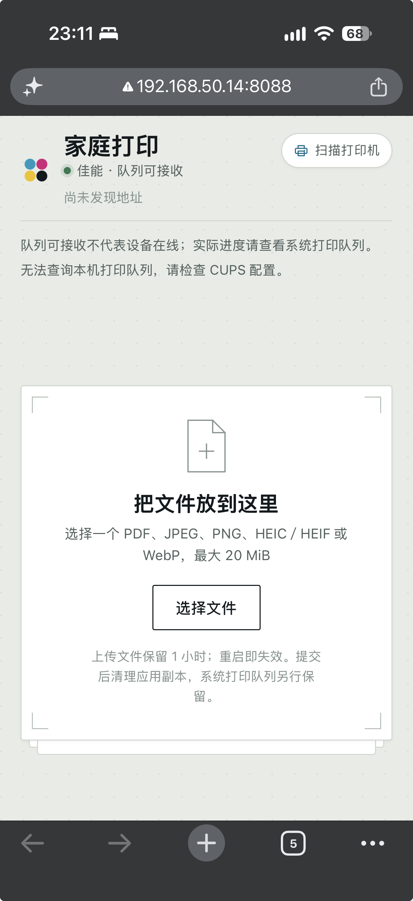

# OpenCanon 家庭打印

局域网内的 Canon E560 打印服务。Go 直接使用 BJNP 与打印机通信，Poppler 和 Gutenprint 负责生成 E560 设备数据。运行时不需要 macOS、Canon 专有驱动或 CUPS 服务；支持 Linux ARM64，Go 主程序不使用 cgo，独立的 `opencanon-render` 辅助程序链接开源 libgutenprint。



Gutenprint 将精确型号 `bjc-E560-series` 标为 **EXPERIMENTAL**。软件生成设备数据不等于真实 E560 已验证出纸，颜色、翻面和其他纸张必须以实物验收为准。当前没有用其他型号替代 E560，也没有 CUPS 回退。

## Docker 运行

打印机和服务必须能在局域网互相访问。`.env` 使用打印机地址，不再填写 Mac 的 CUPS 地址：

```dotenv
PRINTER_ADDRESS=192.168.50.24:8611
OPENCANON_PORT=8088
```

上述地址是本机上次确认的 E560 地址；如果设备地址改变，更新该配置。部署到其他机器时填写实际地址，也可使用能被容器解析的主机名。BJNP 使用设备上的 UDP/TCP 8611：UDP 用于身份、状态和会话，TCP 用于打印数据。

```sh
docker compose up -d --build
```

访问 `http://<服务所在机器地址>:8088`。手机连接相同局域网。服务没有登录功能，不应配置公网端口转发。

本机已将独立版本构建为 `opencanon:local` 并更新 Compose 容器 `opencanon-opencanon-1`。本机访问 `http://localhost:8088`，同一局域网访问 `http://192.168.50.14:8088`；打印机为 `192.168.50.24:8611`。使用 `docker compose ps` 查看状态、`docker compose logs -f opencanon` 查看日志、`docker compose restart opencanon` 重启。重启策略为 `unless-stopped`，需要 Docker／OrbStack 本身已启动。

`PRINTER_ADDRESS` 留空时通过 IPv4 BJNP 广播发现。Docker 桥接网络一般不能把局域网广播传到物理网卡，因此容器部署推荐显式配置设备地址。指定地址时，“重新扫描”直接验证该设备，不依赖广播、Bonjour 或宿主机 CUPS。

仅验证设备身份与状态、不发送打印数据：

```sh
docker compose run --rm opencanon \
  -probe -printer-address=192.168.50.24:8611 \
  -data-dir=/tmp/opencanon-probe
```

镜像以非 root 用户运行，将上传数据保存到 `opencanon-data` 卷。容器可直接访问打印机即可，不需要开放宿主机 631 端口、挂载 CUPS socket 或安装 Canon 驱动。

## Linux 本机运行

构建需要 Go 1.26.1、C 编译器和源码构建工具。辅助程序固定 Gutenprint 源码版本并修补极小图像的行指针数组分配错误，再静态链接该库；不使用发行版未修补的动态库。Debian bookworm：

```sh
sudo apt-get update
sudo apt-get install build-essential pkg-config curl ca-certificates xz-utils patch flex gettext \
  poppler-utils imagemagick img2pdf
make -C native/render GUTENPRINT_PREFIX="$PWD/bin/gutenprint"
native/render/opencanon-render --check
make -C native/render test GUTENPRINT_PREFIX="$PWD/bin/gutenprint"
go test -race ./...
go build -o bin/opencanon ./cmd/opencanon
./bin/opencanon -listen 0.0.0.0:8088 \
  -printer-config config/printer.json \
  -printer-address 192.168.50.24:8611 \
  -renderer ./native/render/opencanon-render \
  -pdfinfo /usr/bin/pdfinfo -pdftoppm /usr/bin/pdftoppm
```

`--check` 必须确认 `bjc-E560-series model=12000560` 及所需参数存在。缺少编码器、模型数据、Poppler 或可用设备时，页面仍可访问，但保持不可打印。安装或修改依赖后重启服务。

首次构建会下载并校验 Gutenprint 源码。保留 `bin/gutenprint`：辅助程序运行时仍需其中的模型数据，复制可执行文件时必须同时保留该绝对路径下的数据。Docker 构建使用 `/opt/opencanon/gutenprint` 并随镜像携带模型数据、对应源包与补丁。

默认数据目录为 `$HOME/.local/share/opencanon`，可用 `-data-dir` 指定。不要同时启动两个使用同一数据目录的进程：服务启动会清除上次运行遗留的上传目录。

macOS 也可自行编译相同 Gutenprint 辅助程序后运行 Go 服务；macOS 图片预处理使用系统 sips，但设备通信和打印编码不使用 Canon macOS 驱动。`deploy/local.opencanon.plist` 保留为这台机器的可选 LaunchAgent 配置，需要先安装独立辅助程序并核对绝对路径，不属于当前 Docker 部署入口。

## 打印数据与状态

1. 上传 PDF 或静态 JPEG、PNG、HEIC／HEIF、WebP；PDF 由 pdfinfo 验证页数与打印权限，图片先转换为 PDF。
2. 服务校验纸张、页码、份数、颜色和单双面。Poppler 只渲染选定页；Gutenprint 对精确 E560 型号生成 Canon XML、ESC 命令和压缩栅格。
3. 完整设备流生成成功后，Go 建立 BJNP 会话，检查资源，分块发送并逐帧验证接收数量。编码失败时不会发送半份文档。
4. 设备确认接收全部数据且会话结束后返回本服务生成的任务 ID。单台设备同一时刻处理一个提交；其他提交遇到忙状态返回失败，不在应用内无限排队。

同一 `documentId` 成功后再次提交返回相同任务 ID，不再次打印。传输中部分接收、ACK 丢失或断连可能意味着设备已接收数据，此时文档进入 `uncertain`，禁止自动重发。只有设备完整确认当前帧接收 **0 字节** 时才按 BJNP 流控等待后重送该帧，等待有固定截止时间。

BJNP 接收确认不能证明出纸，设备当前忙也不能归属到某个历史任务。网页展示“设备已接收打印数据”；任务最终状态保持 `unknown`，另用说明文字报告设备忙、空闲、错误或无法连接，不伪造任务级 `processing` 或 `completed`。设备错误可能发生在接收之后，请检查面板和实际纸张；不要通过重新上传绕过不确定提示。页面遇到未知状态停止自动查询，最长查询时间为 60 秒。

直接发送需要等待渲染和设备接收，确认后请保持页面打开。整单提交最多 25 分钟，渲染最多 20 分钟，单页 Poppler 最多 90 秒；取消或超时会结束相关进程和网络操作。服务没有跨重启的打印任务恢复，重启前应等待发送结束，重启后旧文档和任务查询失效，不能据此判断未出纸。

## 文件、纸张与资源

- 上传单文件最大 20 MiB，请求体最大 21 MiB；份数 1–99。损坏、密码保护或禁止打印的 PDF 被拒绝。
- 页码支持 `1-3,5`、中文逗号及空白，去重并升序；拒绝倒序、空片段和越界。图片只有第 1 页；HEIC 多张静态图仅取首图，不支持动画、SVG 或 TIFF。
- 支持原有 15 种纸张。介质映射及公开源码依据见 [config/README.md](config/README.md)。照片纸选项对应 Photo Paper Plus Glossy II，不能在普通纸上据此判断照片输出质量。
- 自动双面仅支持 A4／Letter 普通纸。按份输出完整文档，每份奇数页末尾编码空白背面，避免下一份从背面开始。3 页 × 2 份双面估算 4 张纸。
- 按比例居中到有边距的可打印区域；横向内容可自动旋转。长／短边指实际纸张边；灰度不保证只使用黑墨。
- 文档保留 1 小时，每 5 分钟清理；设备接收后立即删除应用副本。设备自身的缓存或日志不由应用清除。
- 渲染使用文件流和逐行像素读取；单张 PPM 最大 64 MiB，原始栅格合计及设备流分别最大 1 GiB。超限明确失败，不截断内容继续打印。详细资源控制见 [native/render/NOTICE](native/render/NOTICE)。

## 设备发现

页面首次没有有效缓存时自动扫描；之后展示上次成功发现的地址与时间，点击“重新扫描”更新。配置了 `-printer-address` 时仅验证指定设备；未配置时通过 BJNP 广播发现并只接受精确 E560 型号。发现多个 E560 时要求管理员明确指定地址，不随机选择。

成功结果以 0600 权限原子保存到数据目录的 `printer-discovery.json`。失败保留上次确认记录并显示原因；缓存不是在线证明。旧的 `canonijnetwork://` 缓存不会当作 BJNP 确认记录使用，需要重新扫描。

## HTTP 接口

- `GET /api/printer`：能力、禁止组合、直接设备可用状态及发现缓存；不触发扫描。
- `POST /api/printer/scan`：无请求体和查询参数，要求 `X-OpenCanon-Request: 1`；409 表示正在扫描，503 表示失败。
- `POST /api/documents`：multipart 单字段 `file`；201 返回 `{id,name,kind,pageCount,expiresAt,previewUrl}`，不暴露路径。
- `GET /api/documents/{id}/preview`：图片 JPEG 预览；PDF 无内置预览器。
- `POST /api/print-jobs`：JSON `{documentId,mediaId,pageRanges,copies,colorMode,duplex}`，要求 `X-OpenCanon-Request: 1`。颜色 `color/mono`，双面 `single/long/short`；返回 `{id,state:"submitted"}` 仅表示接收完成。
- `GET /api/print-jobs/{id}`：仅查询本进程提交且未过期的任务，返回 `{id,state,message}`。

变更请求校验同源 Origin，不开放 CORS。错误格式 `{error:{code,message}}`；404 表示未知或过期，413 超限，422 文档或设置无效，503 依赖、设备、编码/传输失败或提交结果不明。`submission_uncertain` 必须按禁止自动重试处理。

## 模块与许可

`cmd/opencanon` 入口；`internal/httpapi` HTTP；`internal/bjnp` Go 设备协议；`internal/discovery` 发现与地址持久化；`internal/render` PDF 渲染调度；`native/render` Gutenprint 辅助程序；`internal/printer` 能力、串行提交与接收凭据；`internal/document` 上传处理；`internal/store` 文档生命周期；`internal/web` 网页。`design/index.html` 保留为设计原文件。

Go BJNP 实现参考公开协议事实，来源固定于 [cups-bjnp](https://github.com/bitwiseworks/cups-bjnp-os2/tree/5f1a04542c5e1a714344563972cd1914b4a19185)。独立 C 辅助程序及 Gutenprint 使用 GPL-2.0-or-later；许可、来源及分发对应源码要求见 [native/render/NOTICE](native/render/NOTICE) 和 [COPYING](native/render/COPYING)。镜像携带辅助程序源码与许可；对外分发镜像还需履行所含第三方软件的对应源码义务。

## 验证边界

本次运行 `go test -race ./...`：97 项通过；最终 Linux ARM64 镜像通过 38 项真实编码组合（15 种纸张各彩色/单色，以及 A4/Letter 两种颜色的长/短边双面）。原生回归覆盖 5×7 照片纸边界、3 页 × 2 份长边双面的 8 面输出、1×1 双面图像；修补库的极小图像用例通过 Valgrind，0 errors。辅助程序的动态依赖仅 libc/libm，不加载系统 Gutenprint 或 libcups。

最终镜像经 HTTP 上传真实 3 页 PDF、彩色长边双面 2 份，BJNP 接收端收到 7,958,566 字节，检查到一个 StartJob/EndJob 及完整 8 面命令；重复提交返回相同凭据，设备全局忙时仍返回任务 `unknown`。最终移动网页完成上传、确认和接收提示，390px 视口无横向溢出。此前还验证了选页、短边双面、图片/照片纸、断线后禁止重印。接收端均为本地 BJNP 模拟设备，记录的是真实编码器生成的 Canon 数据，不代表物理打印成功。

2026-11-04 实机已上线，确认 `192.168.50.24:8611` 为 E560、固件 1.060。发现并修复 XML 状态与 4 字节会话扩展兼容问题。首次 A4 彩色长边双面测试发生零接收流控超时；用户确认仅正面出纸且内容缺失，不能算打印成功。随后分离网络与流控时限，完整回归为 159 项通过；复测前必须取消旧任务并确认设备恢复空闲。实机处理和取消阶段曾返回截断 XML，此时保持不可用，不猜测就绪。

取消与重启后设备一度停在 `canceling` 并返回截断 XML；等待其恢复完整 `idle` 后，已完成第二轮实机测试 `E560-20261104-205503`：两页 A4、彩色、长边双面、1 份，直接 BJNP 提交耗时 61.82 秒，返回 `201 submitted`，随后设备从 `processing` 回到完整 `idle`。用户现场确认一张纸正反面内容完整、四色和文字正常、翻面方向正确。本次验证使用隔离 Linux 实例，没有切换常驻服务；其他纸张、短边双面、单色及多份组合仍需各自的实物验收。

实机验收后已按用户要求更新正式 Compose 服务，保留 `opencanon_opencanon-data` 数据卷。部署验证：容器运行、`unless-stopped` 重启策略、8088 端口映射正常；局域网首页与发现接口返回 200，设备能力接口报告 `available: true`、地址 `192.168.50.24`。
